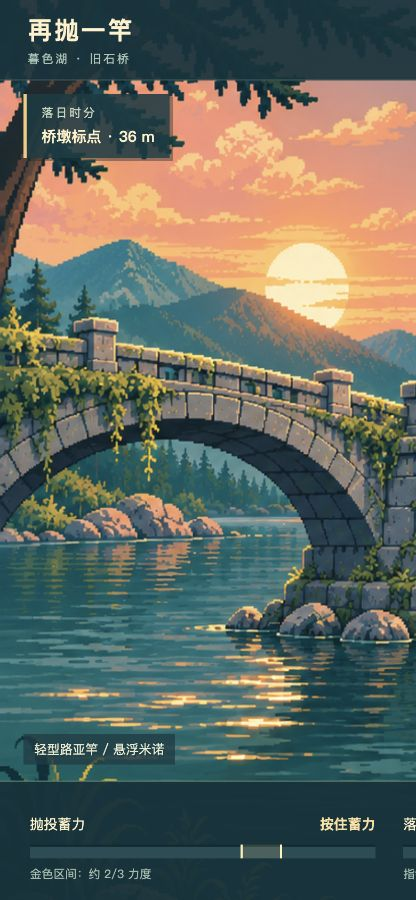

# 再抛一竿 · One More Cast

夕阳湖畔的像素路亚试玩。把米诺抛向旧石桥，用匀收与抽停引诱翘嘴，再控制张力把鱼拉上岸。



## 玩法

1. **抛投**：按住空格或主按钮蓄力；力度约 2/3、精度指针居中时松手，目标是 36 米桥墩标点。
2. **操饵**：选择匀速，按住收线，每 2～3 秒按 J 抽竿，再松手停半秒。落点精度影响鱼的攻击欲上限。
3. **搏鱼**：按住收线拉近距离。张力升高或出现冲刺预警时松手；持续强收会切线，松线太久会脱钩。

| 操作 | 键盘 |
| --- | --- |
| 蓄力、收线 | 按住空格 |
| 出竿、停收 | 松开空格 |
| 抽竿 | J 或 ↑ |
| 慢收、匀速、快收 | 1、2、3 |
| 重开一竿 | R |
| 暂停、继续 | Esc |

手机可使用屏幕按钮，推荐横屏。声音默认关闭，可自行开启；切换到其他窗口会自动暂停。

## 试玩范围

一处钓点、一枚悬浮米诺、一种目标鱼（翘嘴），包含完整的抛投、操饵、搏鱼与渔获循环。

可以直接试玩。登录与注册入口用于建立本机昵称存档，不需要邮箱或密码；没有真实账号认证、云端存档和多人联机。

## 本地运行

不需要安装前端依赖：

```sh
python3 -m http.server 4173 --directory docs
```

用浏览器打开 `http://localhost:4173`。

## GitHub Pages

在仓库的 **Settings → Pages** 中选择 **Deploy from a branch**，分支设为 `main`，目录设为 `/docs`，保存。GitHub 会生成公开试玩地址，之后推送 `main` 会自动更新网页。

## 项目结构

- `docs/index.html`：入口、操作界面与对话框。
- `docs/style.css`：桌面与手机布局。
- `docs/engine.mjs`：独立玩法状态机。
- `docs/app.mjs`：输入、场景动画、音效与本地存档。
- `docs/assets/`：像素场景与鱼类素材。
- `check-engine.mjs`：核心流程、切线、脱钩与落点规则验证。
- `build-offline.mjs`：将图片与逻辑打包成离线单文件。

```sh
node check-engine.mjs
node build-offline.mjs one-more-cast-offline.html
```

像素场景与翘嘴素材使用图像生成工具制作。Canvas 负责实时的鱼、拟饵、鱼线、水波与落点反馈。
